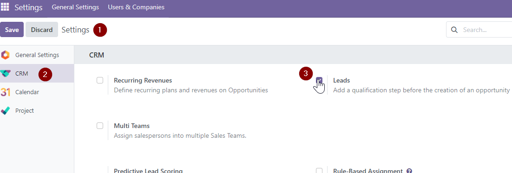
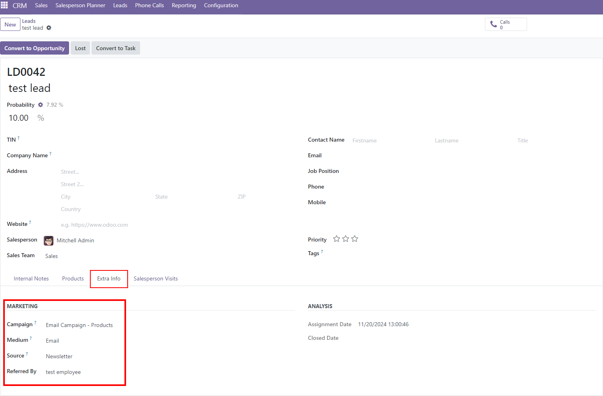
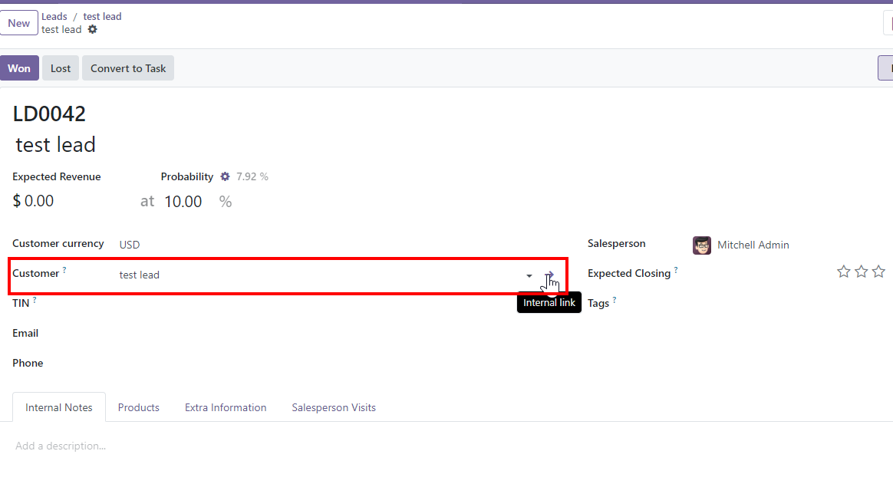
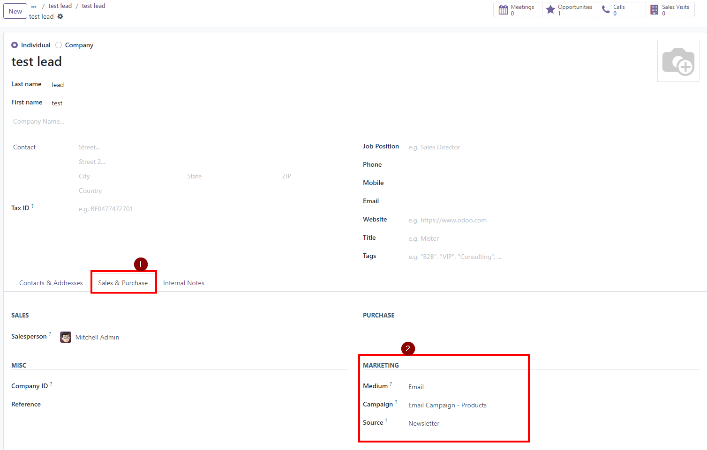

To use this module, here are the steps:

1. If you don't have the "Leads" tab at the top menu in the crm app, go to **Settings \> CRM** and check the box **Leads**.
    
2.  Go to **CRM \> Leads \> Create**.
3.  Fill the required fields, leaving **Customer** empty.
4.  Go to **Extra Info \> Marketing** and fill those fields:
    
5.  **Save**.
6.  Click **Convert to Opportunity**. Since no existing customer matches the
    lead, a new one is created from the lead data.
7.  Click on the name of the newly linked partner.
    
8.  Go to tab **Sales & Purchases**.
9. There you have the new fulfilled fields in the marketing section.
    
